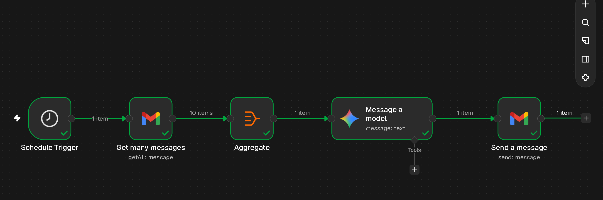
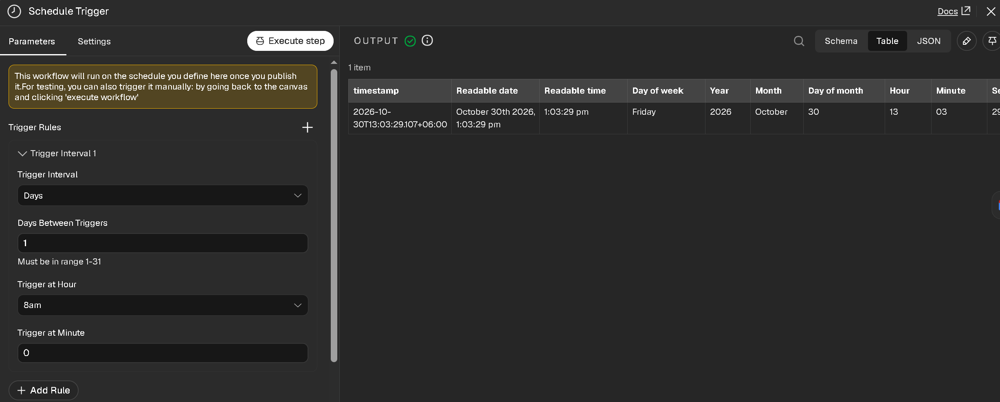
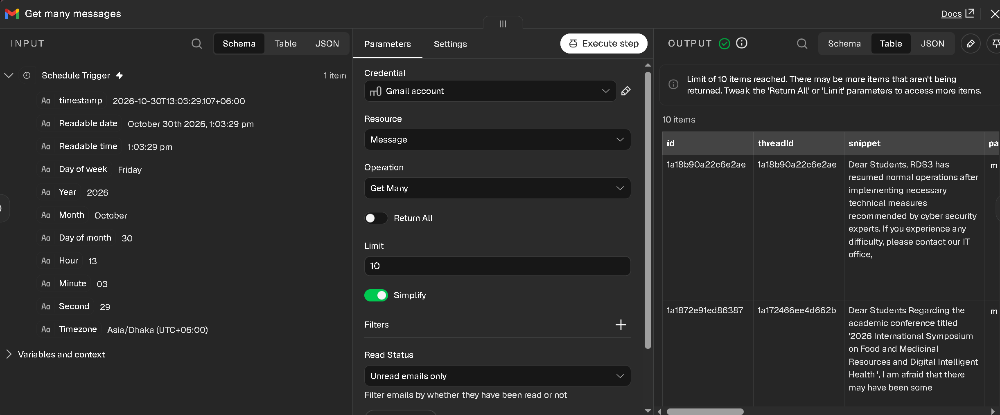
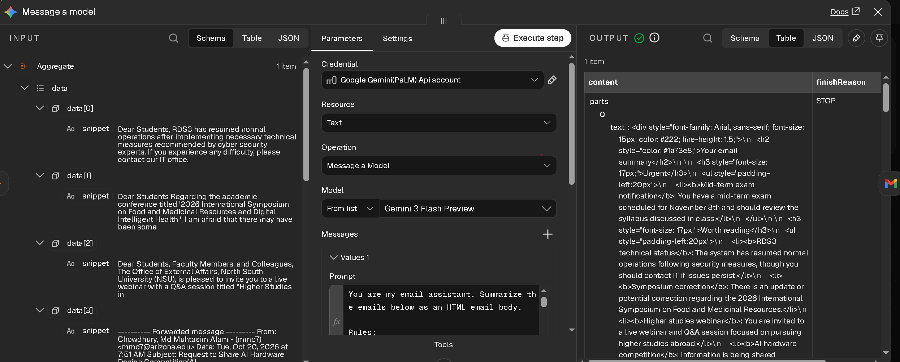
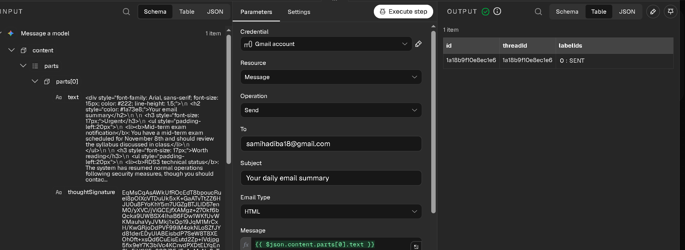
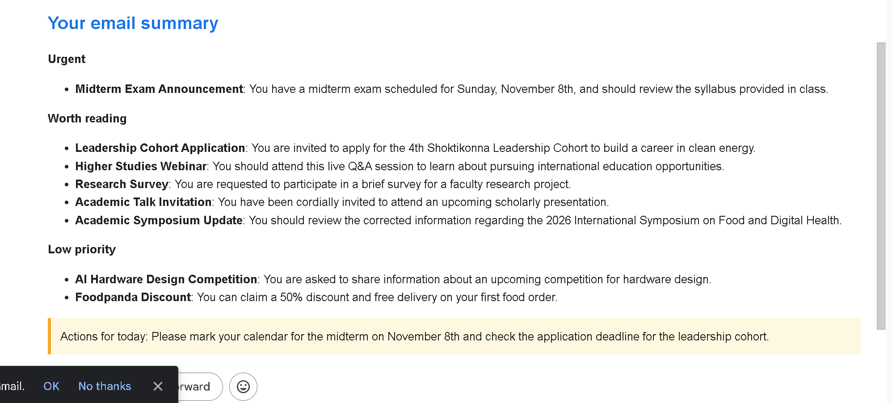

# How I Built an AI Email Summary with n8n

## What it does
Every day at 8:00 AM, this workflow reads my 10 newest unread emails, asks an AI to summarize them, and sends me one short, nicely formatted email. I built it because I get many emails and wanted one quick summary each morning instead of reading them all.



## What you need
- An n8n account (n8n Cloud has a free trial)
- A Gmail account (connected with "Sign in with Google")
- A free Google Gemini API key from aistudio.google.com

Never share your API key. Do not put it in screenshots or files.

## Steps
The workflow has 5 boxes. In n8n, a box is called a *node*.

### 1. Set the schedule
1. In n8n, click **Create Workflow**.
2. Click **Add first step**, search `Schedule`, and click **Schedule Trigger**.
3. Set **Trigger Interval** to **Days**.
4. Set **Days Between Triggers** to `1`.
5. Set **Trigger at Hour** to `8am` and **Trigger at Minute** to `0`.
6. Check the timezone. Click the three dots next to the workflow name, click **Settings**, and look at **Timezone**. By default n8n uses your account timezone. Change it if it is wrong for you.

You should see a clock icon on the canvas.



### 2. Get the emails
1. Click the **+** after the Schedule box. Search `Gmail` and click **Get many messages**.
2. Click **Sign in with Google**, choose your account and click **Allow**.
3. Keep **Resource** as **Message** and **Operation** as **Get Many**.
4. Turn **Return All** off and set **Limit** to `10`.
5. Click **Add Filter**, choose **Read Status**, then choose **Unread emails only**.
6. Click **Execute step**.

You should see a green tick and "10 items" on the right.



### 3. Join the emails into one list
The AI needs one block of text, not 10 separate items.
1. Click **+** after the Gmail box. Search `Aggregate` and click it.
2. Set **Aggregate** to **All Item Data (Into a Single List)**.
3. Keep **Put Output in Field** as `data`.
4. Set **Include** to **Specified Fields** and type `snippet` in **Fields To Include**.
5. Click **Execute step**.

You should see "1 item" with a list called `data`.

### 4. Send them to the AI
1. Click **+** after Aggregate. Search `Google Gemini` and click **Message a model**.
2. Click **Create new credential**. Paste your API key and click **Save**.
3. Set **Model** to **Gemini 3 Flash Preview**. Keep **Resource** as **Text**.
4. Paste this prompt in the **Prompt** box:

```
You are my email assistant. Summarize the emails below as an HTML email body.

Rules:
- Output only HTML. No markdown, no ** or * symbols, and no code fences.
- Use inline styles only. Font: Arial, 15px, color #222, line-height 1.5.
- Start with an <h2> that says "Your email summary" in color #1a73e8.
- Group the emails in order of urgency. Use these headings: "Urgent", "Worth reading", "Low priority".
- Under each heading, give each email one <li> with the topic in <b> tags, then one short sentence on what it wants from me.
- Put each heading's list inside a <ul style="padding-left:20px">.
- Finish with a <div> that has a light yellow background (#fff8e1), padding 12px, a left border of 4px solid #f9a825, and the text "Actions for today:" followed by one or two short sentences.
- Skip any heading that has no emails.
- Maximum 8 emails in total.

Emails:
{{ JSON.stringify($json.data) }}
```

5. Click **Execute step**.

The `{{ ... }}` part turns green. That means n8n fills in your emails there. The output should show HTML text.



### 5. Send the summary
1. Click **+** after Gemini. Search `Gmail` and click **Send a message**.
2. Choose the Gmail credential you already made.
3. In **To**, type your own email address.
4. In **Subject**, type `Your daily email summary`.
5. Set **Email Type** to **HTML**.
6. In the left Input panel, find `content > parts > parts[0] > text`. Drag it into the **Message** box. It becomes `{{ $json.content.parts[0].text }}`.
7. Click **Execute step**.

You should see a green tick and the label `SENT`.



## How to test it
1. Click **Execute step** on each box, one by one, from left to right. Check for a green tick each time.
2. Click **Execute** at the bottom of the canvas to run the whole workflow.
3. Open your inbox. A new email called "Your daily email summary" should be there.
4. When it works, click **Publish** (top right). The workflow now runs by itself every day at 8:00 AM.

Here is a real summary I received (private details hidden):



## Problems I hit and how I fixed them
- **The AI got too much data.** At first, the Aggregate box passed every email field (labels, IDs, sizes) to the AI. I changed **Include** to **Specified Fields** and kept only `snippet`.
- **The email did not show the summary.** I pasted the wrong text into the **Message** box, so the email did not contain the AI summary. I cleared the box and dragged the `text` field from the AI output into it.

## What I would improve
- Add the sender name to each line. Right now the AI only sees the email snippet, so it cannot name the sender. I can add `From` to **Fields To Include** in the Aggregate box.
- Turn off the "This email was sent automatically with n8n" line at the bottom. In the Send box, click **Add option** and look for **Append n8n attribution**.
- Only the 10 newest unread emails are summarized. I could raise the limit.

## Files in this repo
- `README.md`: this guide
- `workflow.json`: the exported workflow (no keys inside)
- `screenshots/`: the pictures used above
